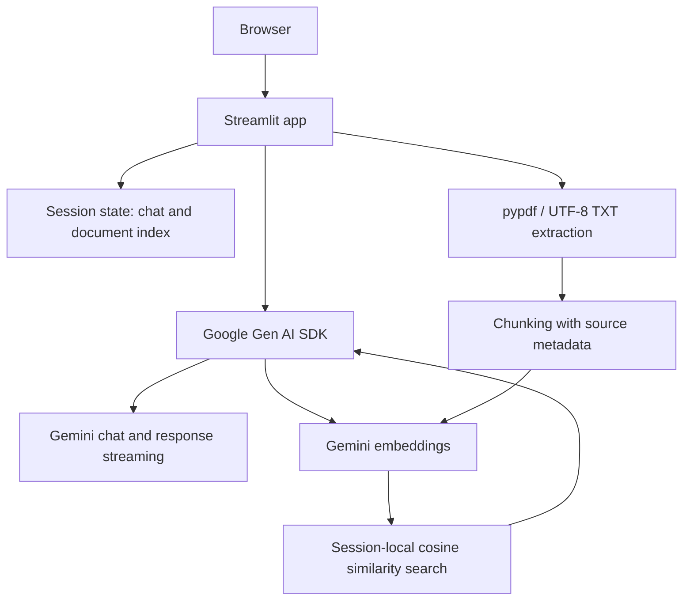

# DocuChat AI

DocuChat AI is a Streamlit application for streaming Gemini conversations and
question answering over user-uploaded PDF and TXT documents. It uses Google's
official Gen AI SDK directly for chat generation and embeddings. The interface
uses a responsive dark-navy and electric-blue theme with a welcome dashboard,
chat workspace, and contextual document panel.

## Features

- Streamed Gemini chat with bounded, multi-turn conversation context.
- Session-state controls for starting and clearing conversations.
- PDF and UTF-8 TXT upload, extraction, semantic retrieval, and source citations.
- Page-number citations for PDFs.
- Separate document-grounded answers that do not reuse unrelated chat history.
- Session-isolated in-memory document indexes and conversation state.
- Safe user-facing API errors and diagnostic logs that omit credentials and content.
- Limits of 10 MB per file, five selected files per indexing operation, 250 chunks
  per document, and 500 indexed chunks per browser session.

## Screenshots

Real browser captures from the responsive Streamlit application:

- [Home dashboard — desktop](screenshots/home-desktop.png)
- [Home dashboard — mobile](screenshots/home-mobile.png)
- [Chat workspace — desktop](screenshots/chat-desktop.png)
- [Chat workspace — mobile](screenshots/chat-mobile.png)
- [Documents workspace — desktop](screenshots/documents-desktop.png)
- [Documents workspace — mobile](screenshots/documents-mobile.png)

## Architecture



`st.session_state` owns the active conversation and document vectors. The
application does not persist uploaded files or embeddings. A session loss,
process restart, or deployment restart discards the indexes; users must upload
and index their documents again.

## Technology

- Python 3.13
- Streamlit 1.67
- Google Gen AI SDK (`google-genai`)
- `pypdf` for PDF text extraction
- `python-dotenv` for optional local `.env` configuration
- pytest for offline automated tests
- System sans-serif font fallbacks; no external font CDN is used

LangChain is not used by the running application. During the earlier Windows
environment setup, Windows Application Control blocked a native `xxhash`
extension reached by LangChain Core imports. The LangChain provider wrapper was
also not used; direct Google Gen AI SDK calls are the verified integration.
Unused LangChain and Chroma packages are excluded from the deployment
requirements.

## Project structure

```text
DOCUMENT-QA-CHATBOT/
├── app.py
├── chatbot/
│   ├── chat_engine.py
│   ├── config.py
│   ├── conversation_memory.py
│   ├── rag_integration.py
│   └── stream_handler.py
├── tests/
├── scripts/
│   ├── gemini_chat_smoke_test.py
│   └── gemini_embedding_smoke_test.py
├── assets/
├── data/
├── samples/
├── .streamlit/config.toml
├── .env.example
├── .gitignore
├── .python-version
├── render.yaml
├── requirements.txt
└── requirements-dev.txt
```

## Local installation

Use Python 3.13 and a project-specific environment:

```powershell
py -3.13 -m venv .venv
.\.venv\Scripts\Activate.ps1
python -m pip install --upgrade pip
python -m pip install -r requirements-dev.txt
```

For Command Prompt:

```bat
.venv\Scripts\activate.bat
```

`requirements.txt` contains pinned runtime dependencies. `requirements-dev.txt`
adds the pinned pytest dependency for local validation.

## Environment variables

Copy the example file and set a Google AI Studio API key locally:

```powershell
Copy-Item .env.example .env
```

| Variable | Purpose | Default |
| --- | --- | --- |
| `GEMINI_API_KEY` | Google Gen AI API credential | Required |
| `GEMINI_CHAT_MODEL` | Gemini chat model | `gemini-3.5-flash-lite` |
| `GEMINI_EMBEDDING_MODEL` | Gemini embedding model | `gemini-embedding-2` |
| `GEMINI_EMBEDDING_DIMENSIONS` | Vector output dimensions | `768` |
| `CHAT_HISTORY_LIMIT` | Retained completed turns | `20` |
| `CHUNK_SIZE` | Text chunk size in characters | `1000` |
| `CHUNK_OVERLAP` | Overlap between text chunks | `150` |
| `RETRIEVER_TOP_K` | Retrieved chunks per question | `4` |

Never commit `.env` or put credentials in source code. `.gitignore` excludes local
environment files, virtual environments, caches, uploaded data, and Streamlit
secrets.

## Run the application

From the project directory:

```powershell
.\.venv\Scripts\python.exe -m streamlit run app.py
```

The local Streamlit server uses its default local port. On Render, the blueprint
uses the platform-provided `PORT` and binds Streamlit to `0.0.0.0`.

## Upload and ask questions

1. Open **Documents** and upload one or more PDF or UTF-8 TXT files.
2. Select **Index documents** and wait for each status to finish.
3. Ask a question in the chat input. The answer uses retrieved excerpts and
   displays source filenames, including page numbers where available.
4. Use **Remove** or **Clear all documents** to discard indexes from the current
   session.

PDFs must contain extractable text. Scanned/image-only PDFs are rejected; OCR is
not available. Corrupt, empty, unsupported, or non-UTF-8 TXT files are reported
as failed. Selected content and indexes are held in memory only; no temporary
document files are written by the application.

## Retrieval workflow

The application extracts PDF text page by page with `pypdf`, or decodes TXT as
UTF-8. It cleans and chunks text while retaining source filename and page
metadata. The configured Google Gen AI embedding model creates
`RETRIEVAL_DOCUMENT` vectors. Each chunk is sent in an individual embedding
request because the verified SDK response for a list of chunk inputs returned a
single vector. A question is embedded using `RETRIEVAL_QUERY`, then compared to
the current session's vectors with cosine similarity. The top-K excerpts are
sent to Gemini without unrelated conversation context.

Gemini is instructed to answer only from the retrieved excerpts, cite their
source labels, and state when the evidence is insufficient. The UI also lists
retrieved filenames and PDF page numbers. Citations show which retrieved sources
were provided to the model; they are not an independent verification of every
claim.

Indexes are in-memory and scoped to a Streamlit session. They are not shared
between users or persisted to disk, and must be rebuilt after session loss or
restart. Per-session file and chunk limits bound application memory, but total
memory consumption still scales with concurrent users and deployment capacity.

## Tests

Automated tests mock Gemini and do not make network requests or incur API charges:

```powershell
$env:PYTEST_DISABLE_PLUGIN_AUTOLOAD="1"
.\.venv\Scripts\python.exe -m pytest -q
Remove-Item Env:\PYTEST_DISABLE_PLUGIN_AUTOLOAD
```

The plugin-autoload workaround is useful in Windows environments where
Application Control blocks optional native pytest plugins. Optional live smoke
tests are separate from pytest:

```powershell
.\.venv\Scripts\python.exe scripts\gemini_chat_smoke_test.py
.\.venv\Scripts\python.exe scripts\gemini_embedding_smoke_test.py
```

## Render deployment

The repository includes `render.yaml` for a Python web service with Streamlit's
health endpoint. To deploy:

1. Push this standalone project repository to GitHub.
2. In Render, choose **New +** → **Blueprint** and connect the repository.
3. Review the service settings from `render.yaml`.
4. Add `GEMINI_API_KEY` as a secret environment variable in Render; do not put it
   in the blueprint or commit it.
5. Apply the Blueprint and wait for the service deployment.
6. Confirm the deployment health check at `/_stcore/health` succeeds.

The blueprint sets Python to the locally tested `3.13.17`, installs
`requirements.txt`, and starts Streamlit bound to `0.0.0.0` on Render's injected
`PORT`. No deployment URL, API credential, or fixed port is embedded in the
application. A successful local health check does not imply a public deployment
has occurred.

## Limitations

- A valid Gemini API key, network connectivity, available model, and API quota
  are required for live chat and document indexing.
- Gemini embedding calls are sequential, one per chunk; indexing can take time
  and consume API quota.
- Document and conversation state is ephemeral, in-memory, and session-scoped.
- No OCR, durable storage, cross-session sharing, authentication, or deployment
  has been implemented.
- LangChain Core imports were blocked by Windows Application Control in the
  development environment; the runtime uses the direct Google SDK instead.
